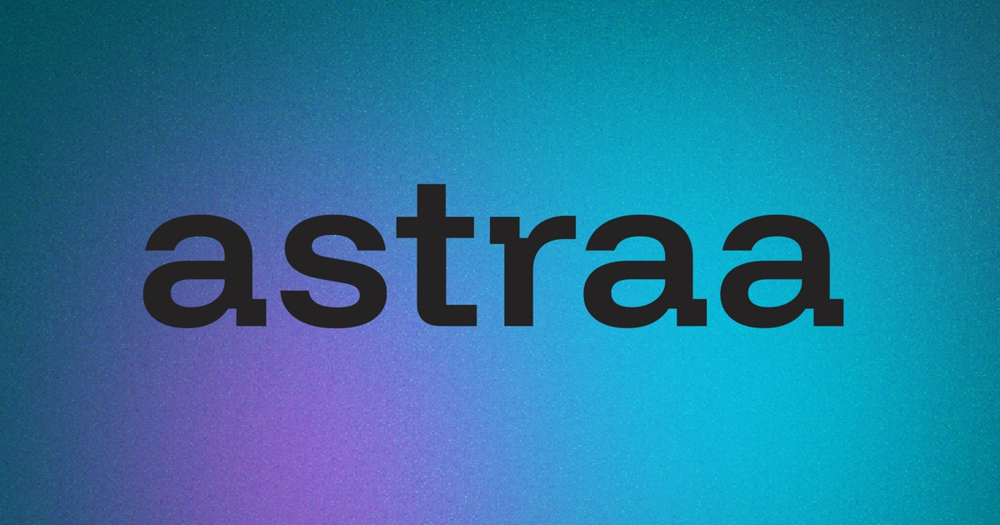

<p align="center">
  
</p>
<p align="center">
  
  
  
  
  
</p>

<h2 align="center">
  Astraa (अस्त्र) browser-based utility toolkit that brings together a collection of powerful tools and games in one place.
</h2 >


<p align="center">
  <a href="https://astraa.notion.site/roadmap">
    
  </a>
  <a href="https://astraa.notion.site/roadmap">
    
  </a>
  <a href="https://astraa.notion.site/">
    
  </a>
  <a href="https://x.com/astraadottech">
    
  </a>
</p>

## Quick Start

### Prerequisites
- **Node.js**: v18.17.0 or higher
- **Package Manager**: npm, pnpm, or yarn

### Installation

1. **Clone the repository**
   ```bash
   git clone https://github.com/puri-adityakumar/astraa.git
   cd astraa
   ```

2. **Install dependencies**
   ```bash
   npm install
   ```

3. **Start the development server**
   ```bash
   npm run dev
   ```

Open [http://localhost:3000](http://localhost:3000) to view the app.

## The Terminal Flavour

The home page and all tool pages open in a **terminal-style interface by default**: a
`guest@astraa >` prompt, a sidebar of tool keys, and a pixel-font ASTRAA banner. Everything
runs locally in your browser — tools are driven by slash commands, either answered inline in
the scrollback or opened in a panel.

### Slash commands

| Command | Aliases | Example | What happens |
|---------|---------|---------|--------------|
| `/calculator` | `/calc` | `/calculator 2+2` | Inline answer `= 4`; bare `/calculator` opens the calculator panel |
| `/units` | `/unit`, `/convert` | `/units 10 km to mi` | Inline answer `10 km = 6.2137 mi` |
| `/base64` | `/b64` | `/base64 hello` · `/base64 decode aGVsbG8=` | Encodes/decodes Base64 inline |
| `/hash` | — | `/hash hello` · `/hash md5 hello` | Inline digest (sha256 by default) |
| `/regex` | `/re` | `/regex /\d+/g a1b22c333` | Match count and matches inline |
| `/json` | — | `/json {"a":1}` | Validates and pretty-prints JSON inline |
| `/password` | `/pw`, `/pass` | `/password` · `/password 24` | Generates a password inline, shown masked |
| `/currency` | `/fx` | `/currency 100 USD to EUR` | Inline fiat conversion at live rates; crypto opens the panel |
| `/text` | `/lorem` | `/text 50 words` · `/text 3 paragraphs` | Generates lorem ipsum placeholder text locally |
| `/image` | `/img` | `/image` | Opens the image resizer panel |
| `/markdown` | `/md` | `/markdown` | Opens the markdown editor panel |
| `/snippet` | `/snippets` | `/snippet` | Opens the code snippet generator panel |
| `/music`, `/sql` | — | `/music` | Coming soon |
| `/help` | — | `/help` · `/help calculator` | Lists every command with usage |
| `/clear` | — | `/clear` | Clears the screen (also `Ctrl+L`) |
| `/theme` | — | `/theme dracula` | Lists or switches the colour scheme |
| `/legacy` | — | `/legacy` | Switches to the legacy interface |

Arguments that do not parse print an `I don't understand "…" . Opening <Tool>…` line and open
the tool's panel, so there is always a way in.

### Responsive layout

The terminal adapts to small screens: at phone widths the sidebar collapses and every tool
panel lays out for a 375px viewport — controls stay reachable, the prompt never overlaps
other content, and nested overlays (select menus, the regex reference sheet, the snippet
customisation sheet, the markdown discard confirmation) each take one `Escape` press before
the panel itself closes.

### Snippet exports

In the terminal, the snippet generator previews fitted to the panel and exports PNGs at the
selected raster size (the chosen dimensions at 1× and 2×). The legacy interface keeps its
original export behaviour — dimensions derived from the on-screen preview — and its pages
are otherwise unchanged.

### Colour schemes

Six terminal colour schemes plus an automatic mode — switch with `/theme <name>` or the
sidebar picker:

- **Mocha** and **Latte** (Catppuccin)
- **Dracula**
- **Tokyo Night**
- **Solarized Light**
- **Rosé Pine Dawn**

With no saved choice, `auto` follows your system setting: Mocha in dark mode, Latte in light
mode. Panels inherit the active scheme.

### Fonts

Three Geist families, all served locally: **Geist Pixel** for the ASTRAA logo and banner,
**Geist Sans** for interface text, and **Geist Mono** for the prompt, commands and output.

### Cookies and privacy

The terminal persists only two cookies, both set client-side for one year:
`astraa_flavour` remembers which interface you chose, and `astraa_term_theme` remembers your
colour scheme. Command history is kept in memory only for the current session — never stored
or transmitted. See the privacy policy on the site (`/privacy`) for details.

### Switching to Legacy

The classic web UI is still there as the **Legacy** flavour: type `/legacy`, or use the
"Legacy UI" toggle in the terminal sidebar, and the same URL renders the legacy page. Your
choice is stored in the `astraa_flavour` cookie, and the legacy navigation's "Try terminal"
control switches back.

## Development

```bash
npm run dev        # Start development server
npm run build      # Production build
npm start          # Start production server
npm run lint       # Run ESLint
npm test           # Run unit tests (Vitest)
npm run test:watch # Run tests in watch mode
```

The dev server listens on [http://localhost:3000](http://localhost:3000) by default; pass a
different port with `npm run dev -- -p 3210` if port 3000 is taken.

## Contributing

See [CONTRIBUTING.md](CONTRIBUTING.md) for guidelines.

---

<p align="center">
  <i>"If you find astraa useful, consider sponsoring the project ❤️"</i>
</p>

