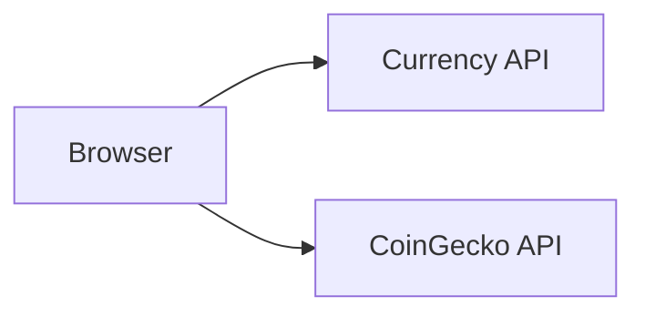

# API Documentation

External API integrations and server actions used in Astraa.

## Table of Contents

- [Overview](#overview)
- [Currency Exchange API](#currency-exchange-api)
- [Cryptocurrency API](#cryptocurrency-api)
- [Lorem Ipsum Generator (Local)](#lorem-ipsum-generator-local)
- [Redis (Upstash)](#redis-upstash)
- [Error Handling](#error-handling)

## Overview

Astraa uses external APIs for live data. All API calls are made client-side or via server actions.



**One internal API route** (`/api/stats`) returns visitor count, GitHub stars, and contributor count. All other data flows through client-side calls or server actions.

## Currency Exchange API

Real-time fiat currency conversion rates.

### Primary API

**Endpoint:** `https://cdn.jsdelivr.net/npm/@fawazahmed0/currency-api@latest/v1/currencies/{currency}.json`

**Method:** `GET`

**Rate Limits:** Unlimited (CDN-based)

### Usage

```typescript
import { getExchangeRate } from "@/lib/api"

// Get exchange rate from USD to EUR
const rate = await getExchangeRate("USD", "EUR")
// Returns: 0.92 (example)

// Convert amount
const amount = 100
const converted = amount * rate
// Returns: 92.00
```

### Implementation

```typescript
// lib/api.ts
export async function getExchangeRate(from: string, to: string): Promise<number> {
  const response = await fetch(
    `https://cdn.jsdelivr.net/npm/@fawazahmed0/currency-api@latest/v1/currencies/${from.toLowerCase()}.json`
  )

  if (!response.ok) {
    throw new Error("Failed to fetch rates")
  }

  const data = await response.json()
  return data[from.toLowerCase()][to.toLowerCase()]
}
```

### Response Format

```json
{
  "date": "2024-01-15",
  "usd": {
    "eur": 0.92,
    "gbp": 0.79,
    "jpy": 148.50
  }
}
```

### Fallback API

**Endpoint:** `https://api.exchangerate-api.com/v4/latest/{currency}`

Used automatically when the primary API fails.

```typescript
// Automatic fallback in getExchangeRate()
try {
  // Primary API call
} catch (error) {
  // Falls back to exchangerate-api.com
  const response = await fetch(`https://api.exchangerate-api.com/v4/latest/${from}`)
  const data = await response.json()
  return data.rates[to]
}
```

## Cryptocurrency API

Real-time cryptocurrency prices via CoinGecko, proxied through this app so the
provider credential never reaches the browser.

### Browsing

`components/currency/crypto-converter.tsx` calls `getCryptoPrice()` from
`lib/api.ts`. That client helper requests the same-origin route
`/api/crypto-price`; it never talks to CoinGecko directly and holds no key.

```typescript
import { getCryptoPrice } from "@/lib/api"

// Get Bitcoin price in USD
const price = await getCryptoPrice("bitcoin", "USD")
// Returns: 45000.00 (example), or null when no price is available

// Get Ethereum price in EUR
const ethPrice = await getCryptoPrice("ethereum", "EUR")
```

### Server route

**Endpoint:** `/api/crypto-price` — `app/api/crypto-price/route.ts`
**Method:** `GET`

**Parameters:**

| Parameter | Type | Description |
|-----------|------|-------------|
| `crypto` | string | Cryptocurrency ID from `lib/crypto-data.ts` (e.g., `bitcoin`) |
| `currency` | string | Fiat ISO code from `lib/currency-data.ts` (e.g., `USD`) |

Only one catalog pair per request is accepted: `lib/currency/pair.ts` rejects
anything outside the two catalogs, so caller input never reaches the provider as
a free-form id or a URL. Responses are cacheable for 60 seconds
(`s-maxage=60`), which caps provider lookups per pair.

**Responses:**

| Status | Body | Meaning |
|--------|------|---------|
| `200` | `{ "price": 45000 }` | Price, or `{ "price": null }` when the pair has none |
| `400` | `{ "error": "invalid_pair" }` | Missing or non-catalog `crypto` / `currency` |
| `502` | `{ "error": "price_unavailable" }` | The provider call failed |
| `503` | `{ "error": "price_unavailable" }` | `COINGECKO_API_KEY` is not configured |

`503` is the fail-safe path: without a key the route makes no provider request
and never falls back to a built-in credential.

### Configuration

Set the server-only `COINGECKO_API_KEY` (`x-cg-demo-api-key`) in the
environment. It must never be prefixed with `NEXT_PUBLIC_`; the value is read in
`lib/currency/coingecko.ts`, which only route handlers import. See
`.env.sample`.

### Provider Response Format

```json
{
  "bitcoin": {
    "usd": 45000.00
  }
}
```

The route reduces that payload to `{ "price": number | null }` before it reaches
the browser.

### Supported Cryptocurrencies

| ID | Name |
|----|------|
| `bitcoin` | Bitcoin (BTC) |
| `ethereum` | Ethereum (ETH) |
| `tether` | Tether (USDT) |
| `binancecoin` | BNB |
| `solana` | Solana (SOL) |

Full list in `lib/crypto-data.ts`.

## Lorem Ipsum Generator (Local)

Placeholder text is generated locally in the browser — no API call is made.

### Usage

```typescript
import { generateLorem } from "@/lib/text/lorem"

// 50 words starting with the classic opener
const text = generateLorem({ count: 50, unit: "words" })

// 3 paragraphs without the opener
const text = generateLorem({
  count: 3,
  unit: "paragraphs",
  startWithLorem: false
})
```

### Parameters

| Parameter | Type | Description |
|-----------|------|-------------|
| `count` | number | Number of units to generate |
| `unit` | `"words" \| "sentences" \| "paragraphs"` | Generation unit |
| `startWithLorem` | boolean (optional) | Start with "Lorem ipsum dolor sit amet" (default true) |

Limits: 1–1000 words, 1–100 sentences, 1–20 paragraphs. The same generator backs the `/text` terminal command and the `/tools/text` page.

## Redis (Upstash)

Server-side data persistence using Upstash Redis.

### Configuration

**Provider:** [Upstash](https://upstash.com)

**Package:** `@upstash/redis` (Vercel KV compatible)

**Authentication:** Environment variables

```bash
# .env.local
KV_REST_API_URL=your_redis_url
KV_REST_API_TOKEN=your_redis_token
```

### Usage

Redis is used directly in `proxy.ts` (Node runtime) — it may import from `lib/`, but the client is instantiated inline behind a guarded factory so missing env means "skip counting", never an error:

```typescript
// proxy.ts
import { Redis } from "@upstash/redis"

function createVisitorRedis(): Redis | null {
  const url = process.env.KV_REST_API_URL
  const token = process.env.KV_REST_API_TOKEN
  if (!url || !token) {
    return null
  }
  return new Redis({ url, token })
}
```

### Use Cases

- Visitor counting on home page (24-hour dedup cookie)
- Stats API (`/api/stats`) returns visitor count alongside GitHub data

## Error Handling

### API Error Pattern

```typescript
import { getUserFriendlyError, logError } from "@/lib/error-handler"
import { useToast } from "@/components/ui/use-toast"

export function CurrencyConverter() {
  const { toast } = useToast()

  async function handleConvert() {
    try {
      const rate = await getExchangeRate(from, to)
      setResult(amount * rate)
    } catch (error) {
      const details = getUserFriendlyError(error)
      toast({
        title: details.title,
        description: details.message,
        variant: "destructive"
      })
      logError(error, { context: "currency-conversion", from, to })
    }
  }
}
```

### Error Response Format

```typescript
interface ErrorDetails {
  title: string      // User-friendly title
  message: string    // User-friendly description
  code?: string      // Error code for debugging
}
```

### Network Error Handling

```typescript
// Automatic retry with fallback
export async function getExchangeRate(from: string, to: string) {
  try {
    // Primary API
    return await fetchPrimaryAPI(from, to)
  } catch (error) {
    console.error("Primary API failed:", error)
    try {
      // Fallback API
      return await fetchFallbackAPI(from, to)
    } catch (fallbackError) {
      console.error("Fallback API failed:", fallbackError)
      throw new Error("Failed to fetch exchange rate")
    }
  }
}
```

### Rate Limiting

| API | Rate Limit | Strategy |
|-----|-----------|----------|
| Currency API (CDN) | Unlimited | - |
| CoinGecko | 10-30 req/min | Demo key |

### Environment Variables

```bash
# .env.local
NEXT_PUBLIC_ENV=dev
KV_REST_API_URL=your_redis_url
KV_REST_API_TOKEN=your_redis_token
# SENTRY_AUTH_TOKEN=your_sentry_token  # optional
```

| Variable | Required | Description |
|----------|----------|-------------|
| `NEXT_PUBLIC_ENV` | Optional | Environment flag (dev/prod) |
| `KV_REST_API_URL` | Optional | Vercel KV / Upstash Redis URL |
| `KV_REST_API_TOKEN` | Optional | Vercel KV / Upstash Redis token |
| `SENTRY_AUTH_TOKEN` | Optional | Sentry source map uploads |
