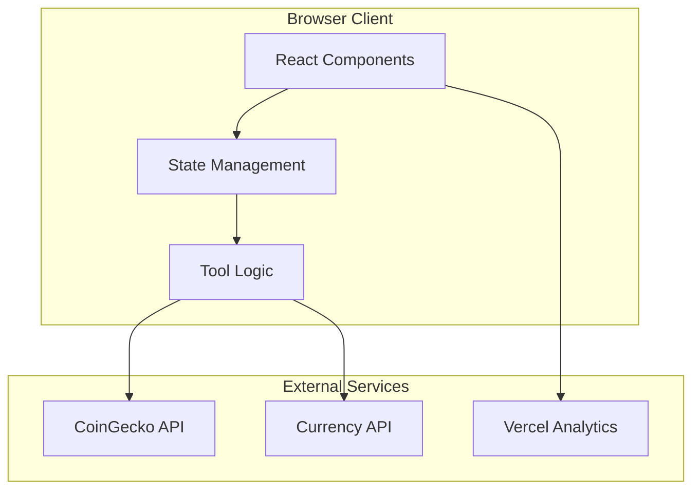
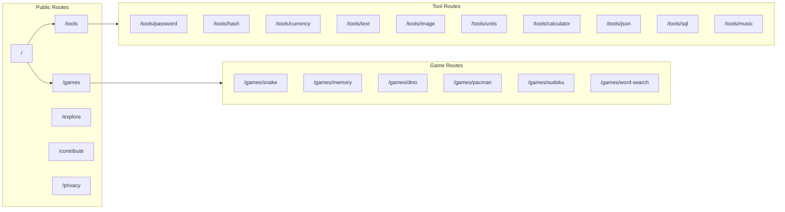
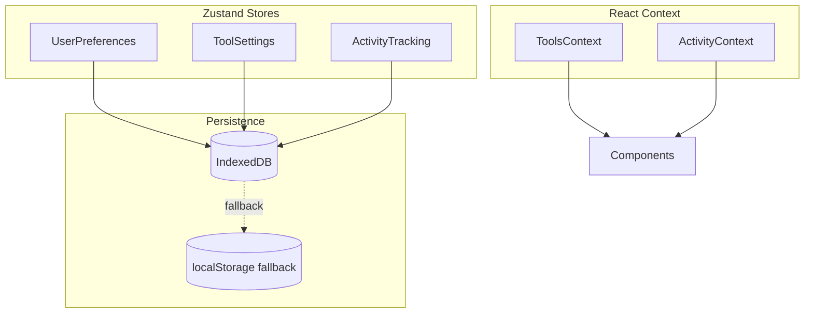
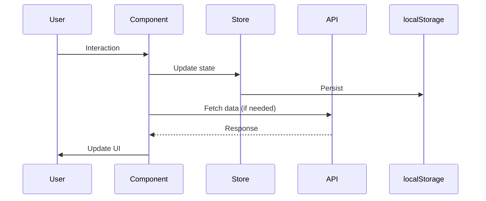
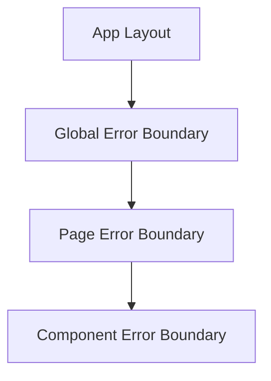
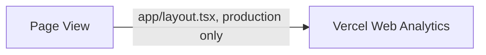

# Architecture

System architecture and design patterns for Astraa.

## Table of Contents

- [System Overview](#system-overview)
- [Frontend Structure](#frontend-structure)
- [Routing Architecture](#routing-architecture)
- [State Management](#state-management)
- [Data Flow](#data-flow)
- [Error Handling](#error-handling)

## System Overview



**Architecture Type:** Client-side rendered SPA with Next.js App Router

**Key Characteristics:**
- Minimal backend — one API route (`/api/stats`); all tool processing happens client-side
- Browser-based processing for tools
- External APIs for live data
- Client-side state persistence (IndexedDB primary, localStorage fallback)
- `proxy.ts` (Node runtime) for flavour routing and visitor counting (Upstash Redis)

## Frontend Structure

```
app/
├── layout.tsx              # Root layout with providers
├── (site)/                 # Legacy flavour (classic UI)
│   ├── layout.tsx          # Legacy nav, footer, container
│   ├── page.tsx            # Landing page
│   ├── tools/              # Tool pages (password, hash, currency, text, image,
│   │                       #   units, calculator, json, sql, music, …)
│   ├── games/              # Game pages (snake, memory, dino, pacman, sudoku, word-search)
│   ├── explore/            # Activity feed
│   ├── contribute/         # Contribution page
│   └── privacy/            # Privacy policy
├── terminal/               # Terminal flavour (default; never visible in the URL)
│   ├── layout.tsx          # Terminal chrome and colour schemes
│   ├── page.tsx            # Terminal home
│   └── tools/[tool]/       # Terminal with the tool panel open
├── error.tsx               # Error boundary
├── global-error.tsx        # Global error boundary
├── not-found.tsx           # 404 page
└── api/                    # API routes
```

### Page Component Pattern

Server component (page) renders client component:

```typescript
// app/tools/password/page.tsx (Server Component)
import { Metadata } from "next"
import { PasswordGenerator } from "@/components/password/password-generator"

export const metadata: Metadata = {
  title: "Password Generator | astraa",
  description: "Generate secure passwords"
}

export default function PasswordPage() {
  return <PasswordGenerator />
}
```

```typescript
// components/password/password-generator.tsx (Client Component)
"use client"

import { useState } from "react"
import { Button } from "@/components/ui/button"

export function PasswordGenerator() {
  const [password, setPassword] = useState("")
  // ...component logic
}
```

## Routing Architecture



**No authentication required** - all routes are public.

### Proxy

```typescript
// proxy.ts (repo root — replaced the deleted middleware.ts; Node runtime)
// Routes the terminal and legacy flavours on the astraa_flavour cookie:
// - "/", "/tools" and registered "/tools/<slug>" are rewritten to the
//   terminal routes unless the cookie is "legacy" (address bar unchanged)
// - Direct hits on /terminal* get a 308 redirect to the public URL
// - Visitor counting on the home page via Upstash Redis, with a 24-hour
//   dedup cookie and a non-blocking increment using next/server after()
```

### Navigation Components

| Route Type | Navigation Component |
|------------|---------------------|
| Landing page | `LandingNavigation` (full header) |
| Tool/Game pages | `FloatingNavbar` (minimal) |

## State Management

### Architecture



### Zustand Stores

```typescript
// lib/stores/user-preferences.ts
interface UserPreferences {
  theme: 'light' | 'dark' | 'system'
  language: string
  accessibility: {
    reducedMotion: boolean
    highContrast: boolean
    fontSize: 'small' | 'medium' | 'large'
    screenReader: boolean
  }
  privacy: {
    analytics: boolean
    errorReporting: boolean
    cloudSync: boolean
    dataSharing: boolean
  }
  keyboardShortcuts: Record<string, string>
}
```

```typescript
// lib/stores/tool-settings.ts
interface ToolSettings {
  [toolId: string]: {
    lastUsed: number
    favorites: boolean
    customSettings: Record<string, unknown>
  }
}
```

### Context Providers

```typescript
// lib/tools-context.tsx
interface ToolsContextType {
  tools: Tool[]
  categories: string[]
  getToolsByCategory: (category: string) => Tool[]
  updateTool: (id: string, updates: Partial<Tool>) => void
}

// lib/activity-tracker.tsx
interface ActivityContextType {
  recentActivity: ActivityItem[]
  popularTools: PopularTool[]
  addActivity: (item: ActivityItem) => void
}
```

## Data Flow

### Tool Data Flow



### Example: Currency Converter

```typescript
// components/currency/fiat-converter.tsx
"use client"

import { useState, useEffect } from "react"
import { getExchangeRates } from "@/lib/api"

export function FiatConverter() {
  const [rates, setRates] = useState<ExchangeRates | null>(null)
  const [loading, setLoading] = useState(true)

  useEffect(() => {
    async function fetchRates() {
      try {
        const data = await getExchangeRates()
        setRates(data)
      } catch (error) {
        // Handle error
      } finally {
        setLoading(false)
      }
    }
    fetchRates()
  }, [])

  // Render logic
}
```

## Error Handling

### Error Boundary Structure



### Implementation

```typescript
// lib/error-handler.ts
export function getUserFriendlyError(error: unknown): ErrorDetails {
  // Sanitize and format error for user display
  return {
    title: "Something went wrong",
    message: sanitizedMessage,
    code: errorCode
  }
}

export function logError(error: unknown, context?: Record<string, unknown>) {
  // Log to console only (Sentry is retired; nothing forwards errors anywhere)
  console.error(error, context)
}
```

```typescript
// Usage in components
try {
  await riskyOperation()
} catch (error) {
  const details = getUserFriendlyError(error)
  toast({
    title: details.title,
    description: details.message,
    variant: "destructive"
  })
  logError(error, { context: "currency-conversion" })
}
```

### Telemetry (Vercel Analytics; Sentry retired)



- **Vercel Analytics** is mounted once in `app/layout.tsx` behind a
  `NODE_ENV === "production"` guard, so the terminal and legacy renderings of
  the site both report the same anonymous page views. It sets no cookies and
  records are not tied to individuals or IP addresses (see the Privacy
  Policy, "Product Analytics and Error Tracking").
- **Sentry is retired** (issue #105): the client (`instrumentation-client.ts`),
  server (`sentry.server.config.ts`), edge (`sentry.edge.config.ts`), and
  `next.config.js` wrapper setups are commented out rather than deleted, and
  the `@sentry/nextjs` dependency stays installed, so the integration can be
  restored by uncommenting them. `app/error.tsx` and `app/global-error.tsx`
  capture nothing and log to the console only.

**Note:** `logError()` in `lib/error-handler.ts` logs to console only.
